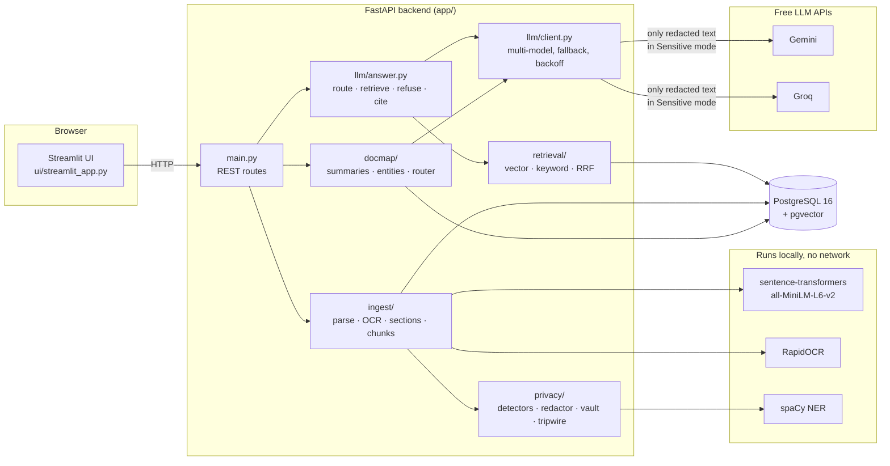
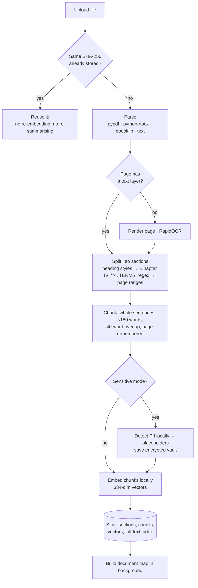
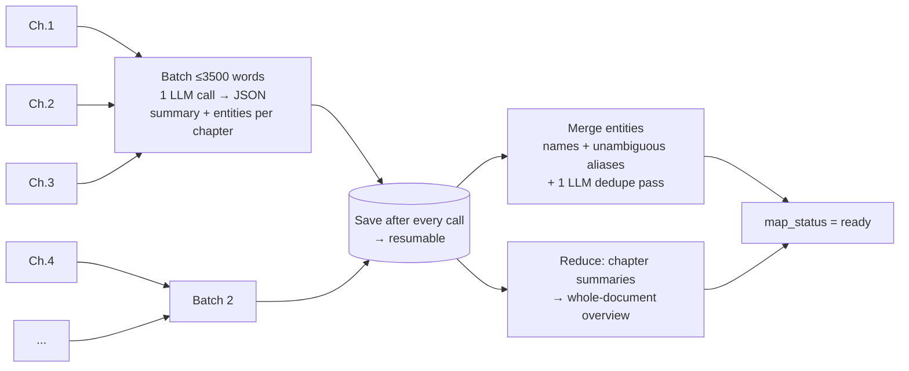
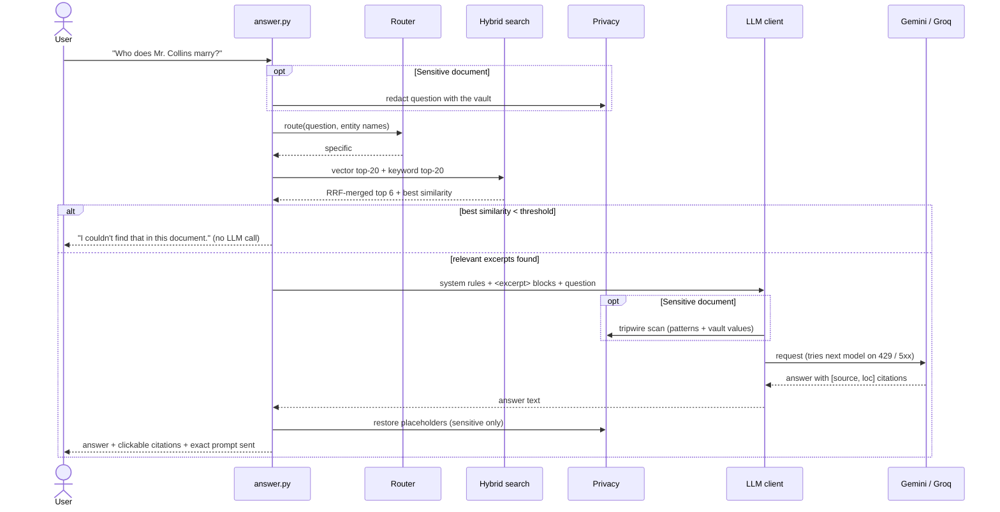
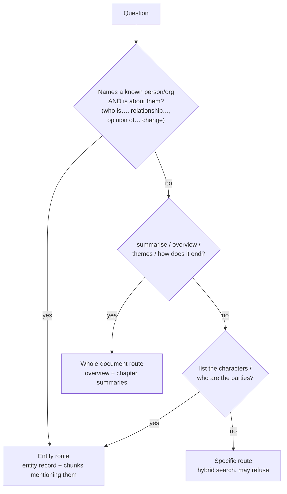
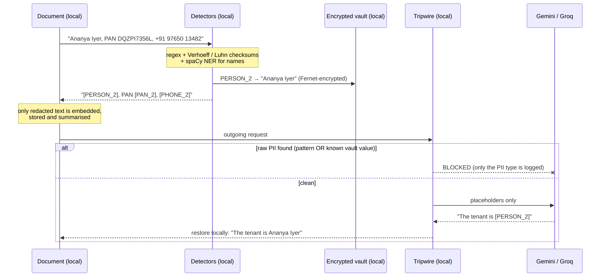
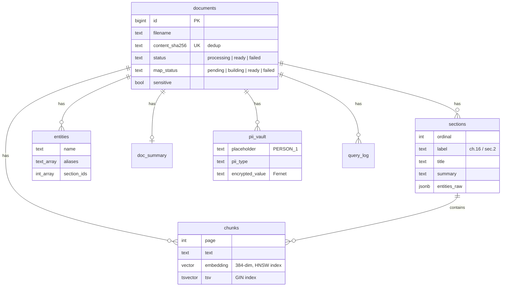
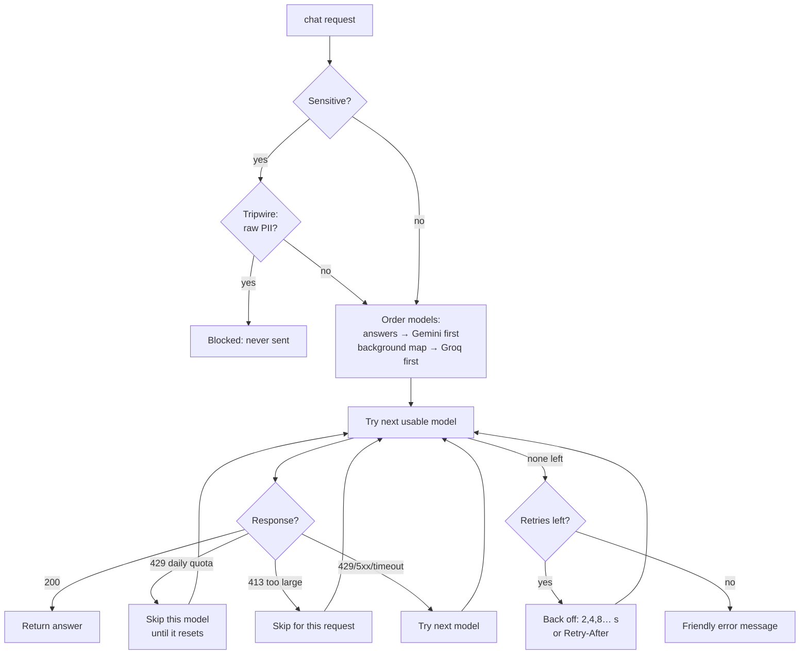

# 📚 AskMyDocs

[](https://github.com/AM2004legend/AskMyDocs/actions/workflows/ci.yml)


**Upload any document and ask questions about it.** Answers come only from the document, cite the
chapter, clause or page, and the app says *"I couldn't find that in this document."* instead of
guessing.

It works on a 300-page novel ("How does the story end?"), a textbook chapter, a scanned PDF, or a
rental agreement. With **🔒 Sensitive mode**, personal data never leaves your computer.

```text
You:          What is the landlord's phone number?
AI received:  ...phone [PHONE_1], email [EMAIL_1]...   →  "The landlord's phone number is [PHONE_1] [document.txt, ch.1]."
You see:      The landlord's phone number is +91 98220 41736 [rental_agreement.txt, ch.1]
```

---

## Contents

- [Features](#features)
- [Architecture](#architecture)
- [How a document is ingested](#how-a-document-is-ingested)
- [How a question is answered](#how-a-question-is-answered)
- [Sensitive mode](#sensitive-mode-pii-redaction)
- [Quick start](#quick-start)
- [API](#api)
- [Evaluation: measured, not guessed](#evaluation-measured-not-guessed)
- [Free-tier reality](#free-tier-reality-measured-oct-2026)
- [Testing and CI](#testing-and-ci)
- [Honest limits](#honest-limits)
- [Project layout](#project-layout)
- [Roadmap](#roadmap)

## Features

| | |
|---|---|
| 📄 **Many formats** | PDF, DOCX, EPUB, TXT, Markdown, PNG/JPG |
| 🔎 **Local OCR** | scanned PDF pages and photos are read with RapidOCR, on your machine |
| 🧭 **Hybrid search** | meaning (pgvector embeddings) + exact words (Postgres full-text), merged with Reciprocal Rank Fusion |
| 📌 **Citations** | every claim cites `[file, ch.N]` or `[file, p.N]`, using the document's own chapter/clause numbers |
| 🙅 **Refuses instead of guessing** | off-topic questions are refused without calling the LLM at all |
| 🗺️ **Document map** | chapter summaries, a whole-document overview and a character/entity index, built once per upload |
| 🔒 **Sensitive mode** | PII replaced by placeholders locally, encrypted vault, tripwire that blocks any leak |
| 🛡️ **Prompt-injection safe** | document text is escaped and wrapped as data; "ignore previous instructions" inside a PDF does nothing |
| 💸 **Runs on free tiers** | Gemini + Groq with quota-aware fallback; embeddings, OCR and NER are local |
| 📊 **Measured** | an eval harness with before/after numbers for every change |

## Architecture



Everything except the final LLM call runs on your machine. The UI only talks to the backend over
HTTP, so the same API could serve a different front end.

## How a document is ingested



<details>
<summary><b>Why these choices?</b></summary>

- **≤180-word chunks:** MiniLM only reads the first ~256 word-pieces. Longer chunks would have
  their endings silently ignored.
- **Overlap:** a fact that sits on a chunk boundary is still fully inside at least one chunk.
- **Real chapter numbers:** a preface would otherwise shift every citation ("Chapter XVI" shown as ch.18).
- **Hash dedup:** the PRD's cost rule, "never re-summarise an unchanged document".
- **OCR only where needed:** pages with a text layer skip OCR entirely.

</details>

### The document map (map-reduce)



Packing several chapters into each call, and getting the summary and the entities back in the
same reply, made the 63-section novel take about 40 calls (including retries). Doing it one call
per chapter for summaries plus one per chapter for entities would be about 130. A batch that's too
large, or a reply that gets cut off, is split in half and retried automatically.

## How a question is answered



### Routing



> The "AND is about them" condition came from the eval. Without it, every question that merely
> *mentions* a character went to the entity route, and specific retrieval fell from 20% to 0%.

## Sensitive mode (PII redaction)

For offer letters, leases, bank statements: tick **🔒 Sensitive mode** at upload.



| Detects | How |
|---|---|
| Email, Indian phone, UPI, IFSC, PAN | regex (PAN's 4th letter = holder type) |
| Aadhaar | 12 digits + **Verhoeff checksum** (random numbers fail 9 times in 10) |
| Card numbers | 13–19 digits + **Luhn checksum** |
| Bank account, date of birth | number/date next to "A/c", "account", "DOB", "date of birth" |
| Names, organisations, places | local spaCy `en_core_web_sm` (best-effort; role words like "Tenant" and ALL-CAPS headings are ignored) |

- **Consistent placeholders:** "+91 98220 41736" and "9822041736" are both `[PHONE_1]`, so the LLM
  can still reason ("[PERSON_1] signed with [ORG_1]").
- **The tripwire has two checks.** Patterns catch structured IDs. The document's own vault values
  catch anything the patterns can't recognise on its own: a bare account number, a DOB without
  "DOB", a name only NER found.
- **Transparency:** a toggle shows exactly what the AI saw, and "What was sent to the AI" shows the
  exact request.
- **PII report:** counts per type and where they appear, never the values. You can also download
  the summary with placeholders (safe to share) or with real values restored.
- **Deletion:** deleting the document deletes its vault (`ON DELETE CASCADE`).

On the synthetic lease in `samples/sensitive/` (all data fake), detection caught every planted
value, and the tripwire caught 100% of them, including context-free ones. That is **one small
synthetic document, not a general accuracy claim.** See [Honest limits](#honest-limits).

## Quick start

### Option A: everything in Docker

```powershell
git clone https://github.com/AM2004legend/AskMyDocs.git
cd AskMyDocs
Copy-Item .env.example .env        # add your keys (below); .env is git-ignored
docker compose up --build          # db + api (:8000) + ui (:8501); preloads samples/
```

Open **<http://localhost:8501>**. The image is CPU-only (no GPU libraries).

### Option B: develop locally (Windows / PowerShell)

Needs Python 3.12 and Docker Desktop.

```powershell
python -m venv .venv
.venv\Scripts\Activate.ps1
pip install -r requirements-dev.txt
Copy-Item .env.example .env
docker compose up -d db              # Postgres + pgvector on localhost:5433
uvicorn app.main:app --reload        # terminal 1 → http://localhost:8000
streamlit run ui/streamlit_app.py    # terminal 2 → http://localhost:8501
```

### Keys (all free)

| `.env` setting | Get it from | Notes |
|---|---|---|
| `LLM_API_KEY` | <https://aistudio.google.com/apikey> | Gemini, used first for answers |
| `FALLBACK_LLM_API_KEY` | <https://console.groq.com/keys> | Groq, strongly recommended (see free-tier limits) |
| `PII_VAULT_KEY` | `python -c "from app.privacy.vault import generate_key; print(generate_key())"` | only for Sensitive mode; keep it safe |

With no keys at all you can still upload, search and see refusals.

## API

| Method | Route | What it does |
|---|---|---|
| `GET` | `/health` | database + LLM status |
| `POST` | `/documents` | upload (`file`, optional `sensitive=true`); returns at once, processing continues in the background |
| `GET` | `/documents` · `/documents/{id}` | list · status, progress, counts |
| `POST` | `/documents/{id}/ask` | `{"question": "..."}` → answer, route, citations, sources, exact LLM payload |
| `GET` | `/documents/{id}/map?redacted=false` | overview, chapter summaries, entity index |
| `POST` | `/documents/{id}/map?force=false` | build / resume the document map |
| `GET` | `/documents/{id}/pii-report` | PII counts per type (sensitive documents only) |
| `DELETE` | `/documents/{id}` | delete everything: chunks, vectors, summaries, entities, vault, logs |

Interactive docs: <http://localhost:8000/docs>.

### Data model



Every child table uses `ON DELETE CASCADE`, so one `DELETE` removes everything about a document.

### LLM client: built around the free tiers



## Evaluation: measured, not guessed

`eval/questions.yaml` has 22 questions over 2 documents, tagged *specific / whole-document /
entity / unanswerable*. The novel's questions are still `draft` (chapters verified against the
text, awaiting human review). The lease questions are exact, since the document was written for
the test.

```powershell
python eval/run_eval.py                    # routing, retrieval hit rate, refusal: free, no LLM calls
python eval/run_eval.py --answers --grade  # real answers, LLM-graded (uses quota)
python eval/pii_recall.py                  # planted-PII detection on the synthetic lease
```

| Run (2026-10-24) | Route ok | Retrieval hit | Refusal ok | Correct |
|---|---|---|---|---|
| Novel: baseline, no document map | 50% | 38% | 83% | – |
| Novel: + document map, first router | 40% | 25% | 83% | – |
| Novel: + router fix | **100%** | **50%** | 83% | – |
| Both docs, real answers, graded | 100% | 73% | **91%** | 61% |
| Lease only (Sensitive mode), graded | 100% | 100% | 100% | 88% |

**What the numbers taught us**

- ✅ **The document map works:** whole-document questions went from 0% to 100% routed and retrieved.
- 🐛 **The eval caught a regression.** A greedy router made retrieval *worse* (20% → 0%). Fixed and re-measured.
- 🙅 **Refusal:** the similarity threshold only catches off-topic questions ("Kubernetes" 0.11 vs
  "Darcy's email" 0.56). With real answers, the grounded prompt refused 4/4 unanswerable questions.
- ⚠️ **Weakest spot:** specific questions on the novel (1/5 found). The answer passage usually ranks
  9th–16th. An experiment with bge-small embeddings plus a cross-encoder reranker went from 3/7 to
  5/7 (+~1 s per question). That's the next step, once the eval set is bigger.
- 🧑‍⚖️ **The LLM grader must be spot-checked.** It graded one fully correct answer (Wickham and Darcy) as 0.

## Free-tier reality (measured, Oct 2026)

| Provider | Limit actually hit | How the app copes |
|---|---|---|
| Gemini free | **~20 requests/day per model**; `gemini-2.5-flash` closed to new users | several models per provider (`LLM_MODEL=a,b`); a daily-quota 429 skips that model until reset |
| Groq free | 1000 requests/day, **8000 tokens/minute** | document-map work goes Groq-first, in ~3500-word batches |
| Groq `gpt-oss` | spent 1745 of its 2048 reply tokens on hidden reasoning; JSON cut off | `reasoning_effort=low` → 14 reasoning tokens |

## Testing and CI

```powershell
pytest                   # 97 tests (~30 s); separate askmydocs_test DB
pytest -m "not slow"     # ~1 s: skips embedding / OCR / NER models
ruff check . ; ruff format --check .
```

- The LLM is faked **at the network layer** (a real `LLMClient` with a fake transport), so the
  tripwire, retry and fallback logic run in every test.
- Tests cover the parsers (incl. OCR), section and chunk boundaries, RRF, the router, entity merging,
  429/413/daily-quota handling, prompt injection, the deletion cascade, the refusal path, and
  end-to-end Sensitive mode (no planted value may reach the LLM).
- **CI** (`.github/workflows/ci.yml`) runs lint and the full suite against a pgvector Postgres
  service on every push. A missing database fails CI rather than skipping tests.

## Honest limits

- **Addresses are only partly hidden.** NER doesn't recognise "flat 702, Tower B, … Pune 411045".
  Sensitive mode reduces risk; it is not a compliance guarantee. Use synthetic or your own
  documents for demos.
- Redaction can lower answer quality when the question is about the hidden value itself.
- OCR drops spaces in ALL-CAPS lines ("RENTISPAIDMONTHLY"); handwriting and complex tables are weak.
- Entity merging is heuristic plus one LLM pass; generic aliases ("her mother") can slip in.
- One document per question by design. Google may use free-tier data to improve its products, so
  use Sensitive mode for anything personal.
- The Docker image needs about 2 GB RAM (PyTorch + models), more than most free web hosts offer.

## Project layout

```text
app/
  main.py            FastAPI routes
  config.py          settings from .env (keys are SecretStr)
  db.py              psycopg 3 pool, plain SQL
  embeddings.py      local sentence-transformers
  preload.py         ingest samples/ at startup (idempotent)
  ingest/            parsers.py · ocr.py · sections.py · chunker.py · pipeline.py
  retrieval/         vector.py · keyword.py · hybrid.py (RRF)
  llm/               client.py · prompts.py · answer.py
  docmap/            summaries.py · entities.py · router.py
  privacy/           detectors.py · redactor.py · vault.py · tripwire.py
ui/streamlit_app.py  front end
sql/schema.sql       tables + indexes (applied automatically)
eval/                questions.yaml · run_eval.py · pii_recall.py · results/
tests/               97 tests
samples/             Pride and Prejudice (Project Gutenberg) · sensitive/ = synthetic lease, fake PII
docs/PRD.md          the product spec this was built from
rag.py               the original single-file prototype it grew out of
```

## Roadmap

- [ ] Cross-encoder reranker + bge-small embeddings (measured +2/7 on retrieval; verify on a bigger eval set)
- [ ] Third eval document (a textbook chapter), as the PRD asks
- [ ] Address detection for Sensitive mode
- [ ] Deploy: Hugging Face Spaces (Docker) + Neon Postgres (pgvector)
- [ ] Visual retrieval (ColPali) for scanned or table-heavy PDFs

## Acknowledgements

*Pride and Prejudice* is from [Project Gutenberg](https://www.gutenberg.org/ebooks/1342) (public domain).
All personal data in `samples/sensitive/` is synthetic.
