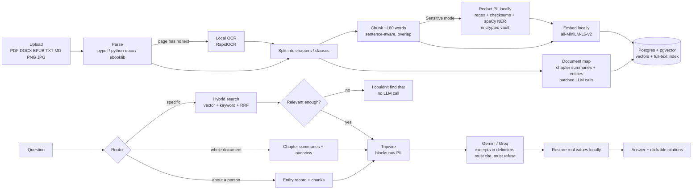

# AskMyDocs

Upload a document (a novel, notes, a textbook chapter, a contract, even a scanned PDF or a photo)
and ask questions about it. Answers come **only** from the document, cite the chapter, clause or
page, and the app says *"I couldn't find that in this document."* instead of guessing.

Parsing, OCR, embeddings and search all run on your machine. Only the final answering step uses a
free LLM API (Gemini, with Groq as automatic fallback), and **Sensitive mode** hides personal data
before anything leaves your computer.

## How it works



| Piece | File | Idea |
|---|---|---|
| Parsing + OCR | `app/ingest/parsers.py`, `ocr.py` | keep page numbers and headings; OCR only pages with no text layer |
| Chapters | `app/ingest/sections.py` | heading styles → "Chapter IV" / "4. TERMINATION" regex → page/word fallback; citations use the document's own numbers |
| Chunking | `app/ingest/chunker.py` | whole sentences, ≤180 words (MiniLM reads only ~256 word-pieces), 40-word overlap |
| Hybrid search | `app/retrieval/*.py` | pgvector cosine + Postgres full-text, merged with Reciprocal Rank Fusion |
| Router | `app/docmap/router.py` | summary questions → document map; questions *about* a person → entity index; the rest → search |
| Answering | `app/llm/answer.py`, `prompts.py` | retrieve → refuse or call LLM → map `[file, ch.N]` back to excerpts |
| LLM client | `app/llm/client.py` | several models per provider, daily-quota aware, fallback, backoff, friendly errors |
| Document map | `app/docmap/*.py` | several chapters per LLM call, summary + entities in one reply, resumable |
| Sensitive mode | `app/privacy/*.py` | detectors, consistent placeholders, Fernet-encrypted vault, tripwire |
| API / UI | `app/main.py`, `ui/streamlit_app.py` | FastAPI backend, Streamlit front end |

## Run it

### Option A: everything in Docker

```powershell
Copy-Item .env.example .env        # add your keys (see below); never commit .env
docker compose up --build          # db + api (:8000) + ui (:8501); preloads samples/ on first start
```

Open <http://localhost:8501>. The image is CPU-only (no GPU libraries).

### Option B: develop locally (Windows / PowerShell)

Prerequisites: Python 3.12, Docker Desktop (running).

```powershell
python -m venv .venv
.venv\Scripts\Activate.ps1
pip install -r requirements-dev.txt
Copy-Item .env.example .env
docker compose up -d db              # just Postgres + pgvector on localhost:5433
uvicorn app.main:app --reload        # terminal 1: backend on :8000
streamlit run ui/streamlit_app.py    # terminal 2: UI on :8501
```

### Keys (all free)

| Setting | Where | Notes |
|---|---|---|
| `LLM_API_KEY` | <https://aistudio.google.com/apikey> | Gemini |
| `FALLBACK_LLM_API_KEY` | <https://console.groq.com/keys> | Groq, strongly recommended (see limits below) |
| `PII_VAULT_KEY` | `python -c "from app.privacy.vault import generate_key; print(generate_key())"` | only for Sensitive mode; losing it means sensitive answers can't be restored |

Without any key you can still upload, search and get refusals.

### Tests, lint, eval

```powershell
pytest                       # 97 tests; separate askmydocs_test DB; the LLM is faked at the network layer
pytest -m "not slow"         # quick run (no embedding/OCR/NER models)
ruff check . ; ruff format --check .
python eval/run_eval.py                       # routing, retrieval, refusal: free, no LLM calls
python eval/run_eval.py --answers --grade     # real answers, LLM-graded (uses quota)
python eval/pii_recall.py                     # how much planted PII the detectors catch
```

CI (`.github/workflows/ci.yml`) runs ruff and the full test suite against a pgvector Postgres
service on every push.

## Sensitive mode (PII redaction)

Tick **🔒 Sensitive mode** when uploading an offer letter, lease, bank statement, and so on.

1. **Detect, locally**: regex plus validators for email, Indian phone, PAN, Aadhaar (Verhoeff
   checksum), cards (Luhn), IFSC, UPI, bank accounts (near "A/c") and DOB (near "DOB"). spaCy
   `en_core_web_sm` finds names, organisations and places (best-effort).
2. **Replace consistently**: "Ananya Iyer" becomes `[PERSON_2]` everywhere, and "+91 98220 41736"
   and "9822041736" share one `[PHONE_1]`. The file name and title are never sent either.
3. **Vault**: placeholder → real value, encrypted with Fernet (key only in `.env`), deleted with the document.
4. **Tripwire**: before every LLM request for a sensitive document, the payload is scanned with
   the regex detectors **and** checked against that document's own vault values. If anything raw
   is found, the request is blocked and only the PII *type* is logged.
5. **Restore, locally**: placeholders in the answer, citations and document map are swapped back
   to real values just before display. A toggle shows exactly what the AI saw, and
   "What was sent to the AI" shows the exact request.
6. **PII report**: counts of each type and where they appear, without the values. You can also
   download the summary with placeholders (safe to share) or with real values restored.

Real example from the synthetic lease (`samples/sensitive/`, all data fake):

```
AI received : The landlord's phone number is [PHONE_1] [document.txt, ch.1].
You see     : The landlord's phone number is +91 98220 41736 [document.txt, ch.1].
```

Detection on that document (`python eval/pii_recall.py`): all 13 planted regex-type values caught,
and with NER on, all 3 names and the organisation as well. The tripwire catches 100% of planted
values, including a bare account number or date of birth that no pattern recognises, because it
also checks the vault. **This is one small synthetic document, not a general accuracy figure.**

## Evaluation

22 questions, 2 documents (`eval/questions.yaml`). Pride and Prejudice questions are still
`draft` (chapters verified against the text; awaiting human review). Lease questions are exact,
since the document was written for the test. "Correct" is LLM-graded and must be spot-checked:
one fully correct answer about Wickham and Darcy was graded 0.

| run (2026-10-24) | route ok | retrieval hit | refusal ok | correct |
|---|---|---|---|---|
| Novel: baseline, no document map | 50% | 38% | 83% | - |
| Novel: document map, original router | 40% | 25% | 83% | - |
| Novel: document map + router fix | **100%** | **50%** | 83% | - |
| Both docs, real answers, graded | 100% | 73% | **91%** | 61% |
| Lease only (Sensitive mode), graded | 100% | 100% | 100% | 88% |

What the numbers taught:
- **The document map works**: whole-document questions went from 0% to 100% correct routing and retrieval.
- **Measuring caught a regression.** The first router sent every question that *mentions* a
  character to the entity index. In a novel that's almost every question, and specific retrieval
  fell from 20% to 0%. Routing only questions *about* a person ("who is…", "relationship…")
  fixed it.
- **Refusal**: the similarity threshold alone catches off-topic questions only (Kubernetes 0.11
  vs Darcy's email 0.56). With real answers, the grounded prompt refused 4/4 unanswerable questions.
- **Weakest spot**: specific questions on the novel (1/5 retrieved). The answer passage usually
  ranks 9th–16th. In an experiment on 7 questions, bge-small embeddings plus a cross-encoder reranker
  improved retrieval from 3/7 to 5/7 (+~1 s per question). Next step, once the eval set is larger.

## Free-tier reality (measured, Oct 2026)

| Provider | Limit we hit | What the app does |
|---|---|---|
| Gemini free | **~20 requests/day per model** | list several models (`LLM_MODEL=a,b`); a daily-quota 429 skips that model until it resets |
| Groq free | 1000 requests/day, **8000 tokens/minute** | document-map work goes Groq-first; batches of ~3500 words fit the token window |
| Groq gpt-oss | spent 1745 of its 2048 reply tokens on hidden reasoning, JSON cut off | `reasoning_effort=low` (14 reasoning tokens) |

The document map for Pride and Prejudice (63 sections, 122k words) needed about 40 calls and
finished on the free tiers after these fixes. Short documents need one or two.

## Honest limits

- **Addresses are only partly hidden.** NER doesn't recognise "flat 702, Tower B, … Pune 411045".
  Detection is risk reduction, not a compliance guarantee. Use synthetic or your own documents
  for demos.
- Redaction can lower answer quality when the question is about the hidden value itself.
- OCR (RapidOCR) drops spaces in ALL-CAPS lines ("RENTISPAIDMONTHLY"); handwriting and tables are weak.
- Entity merging is heuristic plus one LLM pass; generic aliases ("her mother") can slip in.
- One document per question by design. Google may use free-tier data to improve its products:
  use Sensitive mode for anything personal.

## Deploying

Not deployed yet. That needs your accounts. The image needs about 2 GB of RAM (PyTorch + models),
more than most free web hosts give. A realistic free setup: a Hugging Face Spaces Docker Space for
the app, plus a managed Postgres with pgvector (e.g. Neon) via `DATABASE_URL`.

## Project layout

```
app/        backend: config, db, ingest/, retrieval/, llm/, docmap/, privacy/, preload.py, main.py
ui/         Streamlit app
sql/        schema.sql (applied automatically at startup)
eval/       questions.yaml, run_eval.py, pii_recall.py, results/
tests/      pytest suite
samples/    Pride and Prejudice (Project Gutenberg); sensitive/ = synthetic lease with fake PII
docs/       PRD and kickoff notes
rag.py      the original single-file prototype this grew from
```
