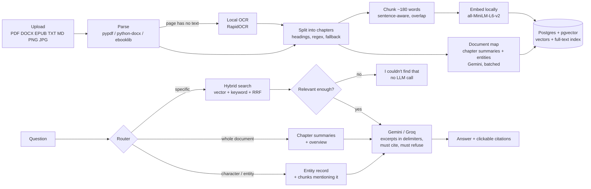

# AskMyDocs

Upload a document (novel, notes, textbook chapter, contract, even a scanned PDF or a photo) and ask
questions about it. Answers come **only** from the document, cite the chapter or page, and the app
says *"I couldn't find that in this document."* instead of guessing.

Everything except the final answer step runs on your machine: parsing, OCR, embeddings and search
are local. The answer comes from a free LLM API (Gemini, with Groq as automatic fallback).

## How it works



| Piece | File | Idea |
|---|---|---|
| Parsing + OCR | `app/ingest/parsers.py`, `ocr.py` | keep page numbers and headings; OCR only pages with no text layer |
| Chapters | `app/ingest/sections.py` | heading styles → "Chapter IV" regex → page/word-count fallback; citations use the book's own chapter numbers |
| Chunking | `app/ingest/chunker.py` | whole sentences, ≤180 words (MiniLM reads only ~256 word-pieces), 40-word overlap |
| Hybrid search | `app/retrieval/*.py` | pgvector cosine + Postgres full-text, merged with Reciprocal Rank Fusion |
| Answering | `app/llm/answer.py`, `prompts.py` | route → retrieve → refuse or call LLM → map `[file, ch.N]` back to excerpts |
| LLM client | `app/llm/client.py` | Gemini first, Groq on HTTP 429, exponential backoff, friendly errors |
| Document map | `app/docmap/*.py` | several chapters per LLM call, summary + entities in one reply, resumable |
| API / UI | `app/main.py`, `ui/streamlit_app.py` | FastAPI backend, Streamlit front end |

## Run it (Windows / PowerShell)

Prerequisites: Python 3.12, Docker Desktop (running).

```powershell
python -m venv .venv
.venv\Scripts\Activate.ps1
pip install -r requirements-dev.txt

Copy-Item .env.example .env      # then edit .env and paste your keys (never commit it)
docker compose up -d db          # Postgres + pgvector on localhost:5433

uvicorn app.main:app --reload    # terminal 1: backend on http://localhost:8000
streamlit run ui/streamlit_app.py  # terminal 2: UI on http://localhost:8501
```

Free keys: Gemini at <https://aistudio.google.com/apikey>, Groq at <https://console.groq.com/keys>.
Without a key you can still upload, search and get refusals; answers and the document map need one.

Tests and lint:

```powershell
pytest                 # 55 tests; uses a separate askmydocs_test database, LLM always faked
pytest -m "not slow"   # quick run without loading the embedding/OCR models
ruff check .
```

## Evaluation

`python eval/run_eval.py` measures routing, retrieval hit rate and refusal on `eval/questions.yaml`
without spending API quota; `--answers --grade` also generates and LLM-grades answers.

Baseline (Pride and Prejudice, 12 draft questions, **no document map yet**, 2026-10-24):

| type | n | route ok | retrieval hit | refusal ok |
|---|---|---|---|---|
| specific | 5 | 100% | 20% | 100% |
| whole_document | 3 | 0% | 0% | 100% |
| entity | 2 | 0% | 100% | 100% |
| unanswerable | 2 | - | - | 0% |

What the numbers say:
- Whole-document and entity routes need the document map (needs an LLM key): expected to rise once it's built.
- Specific retrieval finds the right passage, but often at rank 9-16, just outside the top 6.
  An experiment on the 7 retrieval questions: MiniLM hybrid 3/7, bge-small + hybrid 4/7,
  bge-small + hybrid + cross-encoder rerank 5/7 (+~1 s per question). Too few questions to
  decide; the eval set needs to grow first.
- The similarity threshold only catches off-topic questions ("Kubernetes" scores 0.11). A plausible
  question like "What is Mr. Darcy's email address?" scores 0.56, higher than some real questions,
  so the LLM's instruction to refuse is the real safeguard there.

## Honest limits

- OCR (RapidOCR) is excellent on normal printed text but drops the spaces in ALL-CAPS lines
  ("RENTISPAIDMONTHLY"); handwriting and complex tables are weak.
- The free Gemini tier is roughly 10 requests/minute; the document map for a 300-page novel takes
  ~15 calls (a few minutes). If the daily quota runs out, the map resumes where it stopped.
- Entity merging is heuristic plus one LLM pass; nicknames can still end up as separate entries.
- One document per question by design (no cross-document answers).
- Sensitive mode (PII redaction) is planned for phase 9; until then don't upload documents with
  personal data you don't want sent to the LLM provider. Google may use free-tier data to improve
  its products.

## Project layout

```
app/        backend (config, db, ingest/, retrieval/, llm/, docmap/, main.py)
ui/         Streamlit app
sql/        schema.sql (applied automatically at startup)
eval/       questions.yaml, run_eval.py, results/
tests/      pytest suite
samples/    public-domain books (Project Gutenberg)
docs/       PRD and kickoff notes
rag.py      the original single-file prototype this grew from
```
